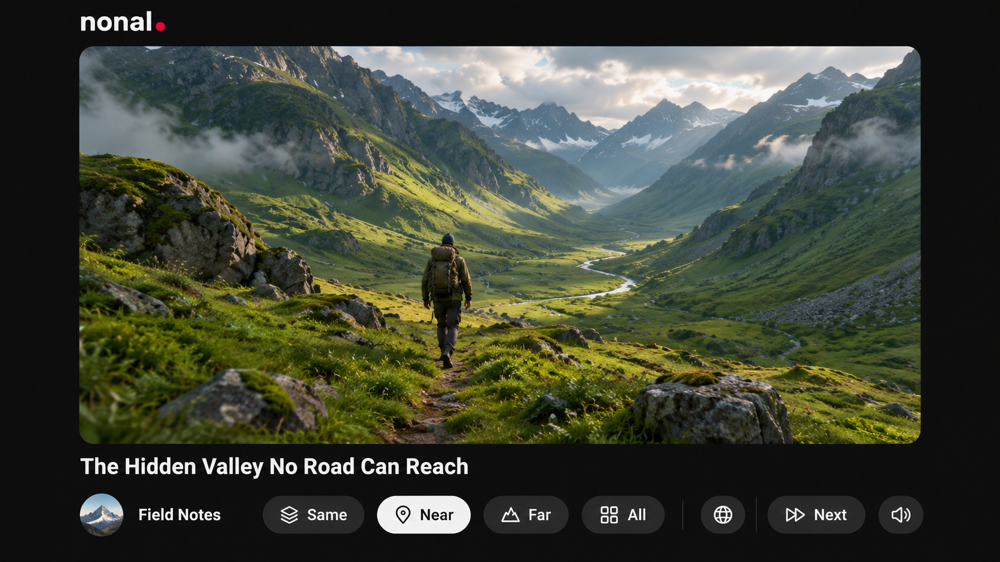

# nonal

A minimal YouTube player for discovering videos outside your recommendation feed.



nonal plays one unfamiliar video at a time. Pick how closely the next video should relate to the one currently playing, then continue with **Next** or the **R** key.

## Features

- **Same** stays on the current topic.
- **Near** moves to a neighboring topic.
- **Far** excludes the current topic and its neighbors.
- Filter videos by Turkish, English, or all languages.
- Start each video at a random point.
- Cache discovered videos locally to reduce API usage.
- Exclude channels you already know.

The first video uses a random topic. Every selection after that is relative to the video on screen.

## Setup

Requires Node.js 20+ and a [YouTube Data API v3](https://developers.google.com/youtube/v3) key.

```bash
git clone https://github.com/berataras/nonal.git
cd nonal
npm install
```

Create `.env.local`:

```bash
YOUTUBE_API_KEY=your_key
```

Start the app:

```bash
npm run dev
```

Open [http://localhost:3000](http://localhost:3000).

## Controls

| Control | Action |
| --- | --- |
| **Same / Near / Far** | Sets the distance for the next video |
| **TR / EN / All** | Filters by spoken language |
| **Next** or **R** | Loads another video |
| **Sound icon** | Mutes or unmutes the player |

Selections are saved in `localStorage`. Played videos are marked in the local catalog and are not selected again.

## Configuration

- Topics, neighbors, and search phrases: `lib/topics.ts`
- Discovery limits: `lib/config.ts`
- Excluded channel ids: `data/known-channels.json`
- Local video catalog: `data/catalog.json` (generated and gitignored)

nonal searches YouTube only when no eligible cached video remains. It makes at most three `search.list` calls for a pick; the default YouTube search quota is 100 calls per day.

## License

[MIT](LICENSE) © 2026 Berat
